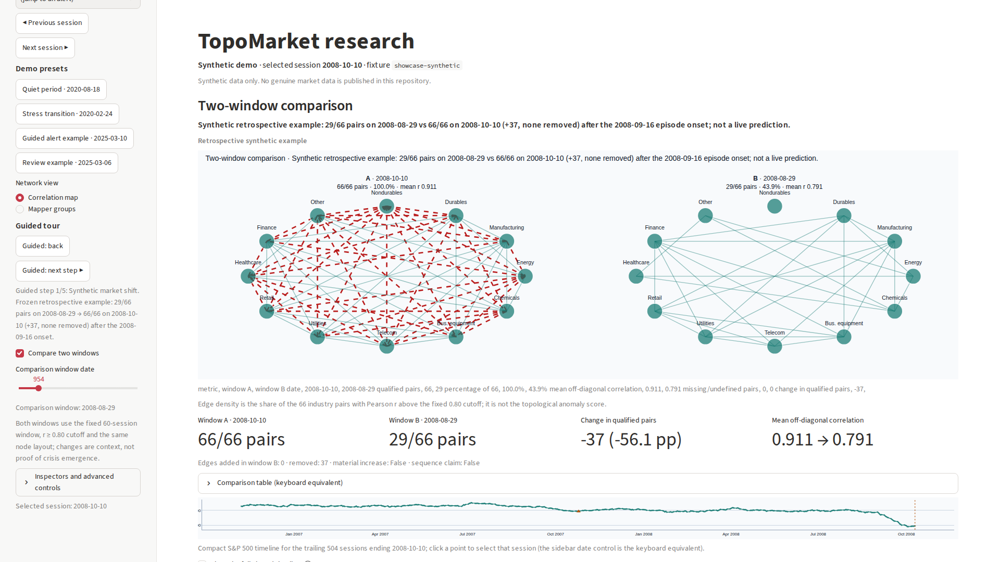

# TopoMarket

[](https://github.com/SergeyGer/TopoMarket/actions/workflows/ci.yml)
[](https://github.com/SergeyGer/TopoMarket/actions/workflows/codeql.yml)
[](LICENSE)

TopoMarket explores how US equity markets move together and tests whether changes in the shape of S&P 500 returns can warn of a 10% decline within 20 sessions. Compare two industry networks, inspect a topological warning, then reveal what happened. The public demo uses synthetic data only.

**Honest result:** on the bundled synthetic holdout (2014-2026; 3,306 common eligible sessions), the TDA policy warned before **0 of 3** episodes and VIX before **1 of 3**. Average precision is 0.0154 for TDA and 0.1187 for VIX. **Early warning remains experimental** - the dashboard labels the result `Experimental market anomaly` and makes no crash-prediction claim.

**Start here:** [Launch demo](https://topomarket-juhbvrgk2k67pnr6qbpfmc.streamlit.app/) &middot; [Watch 60 seconds](docs/watch/index.html) &middot; [Read the mathematics](docs/MATHEMATICS.md) &middot; [Validation evidence](docs/ACCEPTANCE_v1.2.md) &middot; [Quickstart](#quickstart)

<p align="center">
  = 0.80; Window B on 10 October 2008 has 66 of 66; the change is +37 added edges, 0 removed." width="900">
</p>

*Synthetic structure scene from the demo; the app's frozen before/after pair moves from 29 of 66 qualifying pairs on 2008-08-29 to 66 of 66 on 2008-10-10. Every published figure uses the synthetic showcase only.*

## What the app does

- **Structure** - compare two dated correlation networks of 12 industry portfolios (edge: trailing 60-session Pearson r >= 0.80), inspect nodes and Mapper groups, and read the shared S&P 500 / VIX / score timeline.
- **Explain** - trace a warning to its 60-return window, 56-point delay embedding, H1 persistence diagram and percentile against trailing history.
- **Replay** - keep the outcome hidden, then reveal the next 20 sessions (origin, 10% boundary, lowest close, first breach, maximum decline).
- **Validate** - frozen, chronological evaluation with episode recall, average precision, false alerts per year, bootstrap intervals and limitations.

## What the evidence says

| Method | Synthetic episodes warned | Average precision | False alerts / year |
| --- | --- | --- | --- |
| TDA score | 0/3 | 0.0154 | 0.91 |
| VIX | 1/3 | 0.1187 | 0.53 |
| Realized volatility | 0/3 | 0.0556 | 0.23 |

The test target is fixed in advance: a close at or below 90% of the origin within 20 index sessions. The synthetic holdout covers 3,306 common eligible sessions; only 1.33% of eligible origins are positive, so episode counts are small and descriptive. The frozen policy is the 99th percentile for all three methods. The evidence gate returns `Experimental market anomaly`; see [Validation evidence](docs/ACCEPTANCE_v1.2.md) and [docs/EVALUATION.md](docs/EVALUATION.md) for the rules and the full report.

## Watch the film

[Watch 60 seconds](docs/watch/index.html) in the browser: an inline player with English captions and a full transcript. Downloads from the latest GitHub release: [MP4](https://github.com/SergeyGer/TopoMarket/releases/latest/download/TopoMarket_demo_60s.mp4), [SRT](https://github.com/SergeyGer/TopoMarket/releases/latest/download/TopoMarket_demo_60s.srt), [captioned MP4](https://github.com/SergeyGer/TopoMarket/releases/latest/download/TopoMarket_demo_60s_captioned.mp4). Production sources are in [docs/video/](docs/video/).

## Quickstart

Python 3.11+; the synthetic demo needs no credentials or network access.

```bash
git clone https://github.com/SergeyGer/TopoMarket.git
cd TopoMarket
python -m venv .venv
source .venv/bin/activate    # Windows: .venv\Scripts\activate
pip install -e ".[ui]"
streamlit run app.py
```

Or run the command-line demo: `topomarket demo` (add `--json` for machine-readable output). Private research against user-supplied data is described in [docs/DEPLOYMENT.md](docs/DEPLOYMENT.md) and [docs/REFRESH.md](docs/REFRESH.md); private inputs stay outside the checkout.

## Data and provenance

The committed `showcase/` fixture is fully synthetic (snapshot `showcase-synthetic`, seed 4242). No genuine market data, credentials or private ledgers are in Git; screenshots, the social preview and the film use synthetic data only. Genuine data for the private profile is supplied by the owner and stays outside the repository; provider terms are in [NOTICE.md](NOTICE.md). Code is MIT licensed ([LICENSE](LICENSE)); dependency licenses are audited in [docs/DEPENDENCY_LICENSES.md](docs/DEPENDENCY_LICENSES.md). Social preview for GitHub's Open Graph card: [docs/assets/social_preview.png](docs/assets/social_preview.png).

## Repository map

| Path | Contents |
| --- | --- |
| [`app.py`](app.py) | Streamlit entry point; the public demo defaults to the synthetic showcase. |
| [`src/topomarket/`](src/topomarket/) | Data adapters, topology, industry explorer, evaluation and CLI. |
| [`showcase/`](showcase/) | Committed synthetic fixture, presets and evaluation report. |
| [`docs/`](docs/) | Mathematics, evaluation, acceptance, upgrade and video production docs. |
| [`tools/`](tools/) | Demo-video build pipeline and maintenance scripts. |
| [`tests/`](tests/) | Public test suite and opt-in private acceptance tests. |

## Development

See [CHANGELOG.md](CHANGELOG.md) for release notes, [docs/](docs/) for technical documentation, and [docs/UPGRADE_v1.2.md](docs/UPGRADE_v1.2.md) for current work. Run `pip install -e ".[dev,ui]"`, then `pytest -q` and `topomarket release-check`. Contribution and security guidance: [CONTRIBUTING.md](CONTRIBUTING.md), [SECURITY.md](SECURITY.md). Project Wiki: [github.com/SergeyGer/TopoMarket/wiki](https://github.com/SergeyGer/TopoMarket/wiki).

## Citation and contact

Cite the repository as TopoMarket contributors, *TopoMarket* (v1.1.0), https://github.com/SergeyGer/TopoMarket. Questions and bug reports: [GitHub Issues](https://github.com/SergeyGer/TopoMarket/issues). Please do not include private data or credentials in reports.
