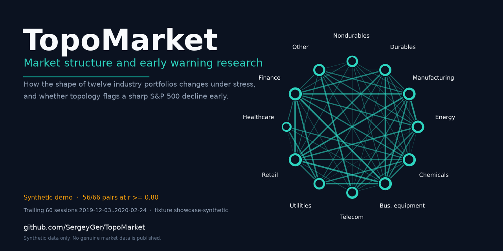
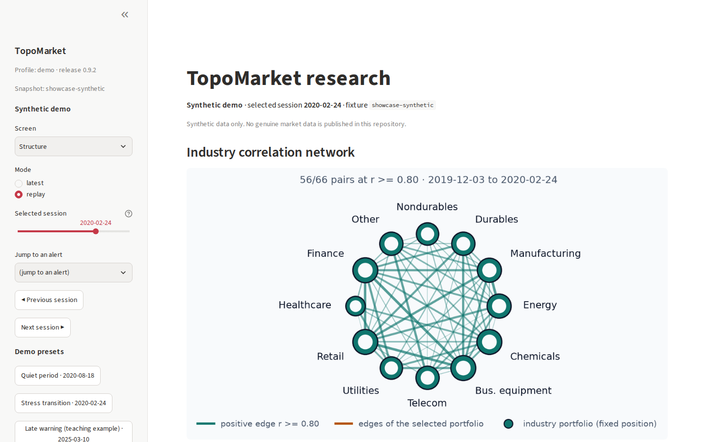

# TopoMarket

TopoMarket is a personal open-source research application that shows how the shape of US equity
returns changes over time and tests whether those changes precede a sharp fall in the S&P 500.
For each available US market close it computes a topological anomaly score; the owner can trace a
reading back to the returns that produced it, replay a historical episode session by session, and
compare warnings with simpler indicators.

The forecast target is fixed before evaluation: a fall of at least **10% from the selected close
within the next 20 index sessions**. The application ships with a credential-free synthetic demo
and a private-research profile; a working dashboard and a positive forecasting result are separate
release decisions.

**Live demo (v1.1.0):** <https://topomarket-juhbvrgk2k67pnr6qbpfmc.streamlit.app/> ·
**Local one-command demo:** `streamlit run app.py` (bundled synthetic showcase, no key) ·
**One-minute demo video:** [watch the synthetic-data walkthrough](https://github.com/SergeyGer/TopoMarket/releases/latest/download/TopoMarket_demo_60s.mp4)
([captions](https://github.com/SergeyGer/TopoMarket/releases/latest/download/TopoMarket_demo_60s.srt))



## Status

| Step | Scope | State |
| --- | --- | --- |
| 1 | Runnable scaffold: package/CLI, Streamlit shell, demo/private profiles, deterministic synthetic fixtures (seed 42), snapshot manifests, CI | **Delivered** |
| 2 | Import the supplied local seed files: four core adapters + optional OFR, hash registry, parser reports, normalized tables (A2) | **Delivered** |
| 3 | Update and recovery paths: HTTPS refresh, conditional GET, staging/validation, atomic snapshot publication, revisions and last-good recovery (A3) | **Delivered** |
| 4 | Persistent homology: delay embeddings, H0/H1, midrank scores, frozen configurations (A4) | **Delivered** |
| 5 | Industry explorer: 60×12 cloud and Mapper graph (A5) | **Delivered** |
| 6 | Chronological evaluation: labels, events, alert policy, uncertainty, private ledger (A6) | **Delivered** |
| 7 | Interactive dashboard: four screens, global date selection, accessibility (A7) | **Delivered** |
| 8 | Package and rehearse the GitHub release (A8) | **Delivered** |
| 9 | Upgrade: authoritative replay date, independent calendars, corrected evaluation, Structure/Replay experience, Community Cloud packaging (v0.9.0) | **Delivered** |
| 10 | Demo video, frozen presets, hosted release and final v1.0 publication | **Delivered** - release `v1.0.0`: video, presets, hosted signed-out verification and live demo |

The v1.0 upgrade plan, defects closed and the build sequence live in
[docs/UPGRADE.md](docs/UPGRADE.md); the acceptance-evidence matrix (A01-A07) is in
[docs/ACCEPTANCE_v1.0.md](docs/ACCEPTANCE_v1.0.md); the tracked work is GitHub milestone
*Upgrade v1.0* and epic [#22](https://github.com/SergeyGer/TopoMarket/issues/22).

Detailed acceptance criteria live in the GitHub Issues and milestones for each step; the technical reference is the [project Wiki](https://github.com/SergeyGer/TopoMarket/wiki).

## Quickstart

Requirements: Python 3.11+, `git`.

```bash
git clone https://github.com/SergeyGer/TopoMarket.git
cd TopoMarket
python -m venv .venv
source .venv/bin/activate        # Windows: .venv\Scripts\activate
python -m pip install --upgrade pip
pip install -e ".[dev,ui]"
```

`.[ui]` adds Streamlit and the chart renderer; the CLI and the analysis package work without them.

Run the deterministic synthetic demo (no network, no credentials, no private data):

```bash
topomarket demo
topomarket demo --json

# Streamlit application: the public synthetic showcase, no flags needed
streamlit run app.py

# Local private research profile (user-supplied data outside the repository)
streamlit run app.py -- --profile private --data-dir /path/to/data
```

CLI reference:

```bash
topomarket --help
topomarket info --profile demo
topomarket synthetic --out ./demo-data --seed 42
topomarket status --data-dir ./demo-data
topomarket validate --data-dir ./demo-data
```

## Release rehearsal (Step 8)

```bash
# offline release checks: versions, hygiene, packaged data, lock, fixtures, public smoke
topomarket release-check
topomarket release-check --json --skip-smoke

# build and validate distributions
python -m pip install build twine
python -m build
python -m twine check dist/*
```

The repository ships a deterministic development lock (`requirements.lock`), an effective Streamlit
Community Cloud definition (`requirements.txt`, pinned, Python 3.12), a release workflow
(`.github/workflows/release.yml`) that runs the public suite with a retained JUnit report, builds and
validates sdist/wheel artifacts (including packaged JSON resources and a private-input guard) and a
synthetic public walkthrough. `CHANGELOG.md` records each step; releases are tagged `v0.x.0` with no
release dates in repository content. The committed `showcase/` fixture is fully synthetic and lets a
reviewer launch the dashboard, follow a replay and inspect an alert without any key. See
[docs/RELEASING.md](docs/RELEASING.md) and [docs/WALKTHROUGH.md](docs/WALKTHROUGH.md).

## Structure and Replay experience (v1.0)

```bash
pip install -e ".[ui]"
streamlit run app.py                      # public synthetic showcase (5,673 sessions)
streamlit run app.py -- --profile private --data-dir /path/to/data
```

The release opens directly on **Structure** with a preselected, warmed-up synthetic scene. Four
screens share one authoritative selected session:



- **Structure** - the 12-industry Pearson-correlation network (fixed node positions, trailing 60
  valid returns, fixed `r >= 0.80` cutoff, `n/66` pair count, node-degree inspector), a Mapper view
  of the same window (groups placed by volatility lens band, node area = membership, edge width =
  shared portfolios, member inspector), the shared S&P 500 / VIX / score timeline (separate aligned
  panels, shared cursor, frozen threshold, alert markers, VIX gaps stay gaps) and the score
  explanation (56-point Takens window with dimension 3 / lag 2, 2-D display-coordinate scatter,
  H1 birth-death diagram with the longest finite lifetime highlighted, industry PCA scatter).
- **Replay** - blind by default. The date is applied before any payload is built; history and
  features are sliced at the cutoff, and "Reveal next 20 sessions" adds only the outcome layer
  (origin close, 10% boundary, lowest close, first breach, maximum decline, pending state). Hiding
  removes the payload again and changing the session resets the reveal state.
- **Validation** - frozen evaluation runs with corrected metrics: episode recall with numerator and
  denominator, false alerts per year, average precision over the complete eligible scored series,
  common eligible dates, bootstrap intervals, limitations, evidence wording
  (`Experimental market anomaly` unless the documented criteria hold) and CSV export.
- **Data** - independent S&P 500 price, VIX and industry-return calendars with observation ranges,
  gaps and stale-map marking, source coverage, last successful refresh, revisions, errors, and a
  private-only validated refresh action. The public demo is read-only.

More synthetic captures: [Replay revealed](docs/assets/screenshots/replay_revealed_desktop.png) ·
[Mapper groups](docs/assets/screenshots/structure_mapper_desktop.png) ·
[Validation](docs/assets/screenshots/validation_desktop.png) ·
[Data](docs/assets/screenshots/data_desktop.png) ·
[mobile 390 px](docs/assets/screenshots/structure_mobile_390x844.png). All captures use the
synthetic showcase only.

Four deterministic demonstration presets are available in the sidebar (quiet period, stress
transition, matched warning, missed/late warning); each is bound to a verified date and the
`synthetic` fixture id (frozen in `showcase/presets.json`). The frozen synthetic showcase has no
credited TDA alert, so the matched slot is a clearly labelled late-warning **teaching example** that
is excluded from the evaluation, as the specification permits. The interface keeps a neutral canvas, teal market series and amber
threshold/alerts, distinguishes signals by symbol and text, stacks at mobile width, exposes table
equivalents and keyboard controls, honours reduced motion, and reuses fixed graph positions across
date changes. Cached date-change p95 is measured against the 500 ms budget by
`topomarket.ui.performance`; the cold public startup is measured separately. See
[docs/WALKTHROUGH.md](docs/WALKTHROUGH.md) and [docs/DASHBOARD.md](docs/DASHBOARD.md).

## One-minute demo video (v1.0)

A ~60 second English demo video shows the released synthetic experience end to end:

- [Master MP4](https://github.com/SergeyGer/TopoMarket/releases/latest/download/TopoMarket_demo_60s.mp4) -
  1920x1080, 30 fps, H.264 High, AAC 48 kHz stereo, 60.0 s, approximately -16 LUFS integrated;
- [English SRT captions](https://github.com/SergeyGer/TopoMarket/releases/latest/download/TopoMarket_demo_60s.srt);
  [captioned playback variant](https://github.com/SergeyGer/TopoMarket/releases/latest/download/TopoMarket_demo_60s_captioned.mp4);
- production source: [storyboard](docs/video/storyboard.json), [narration](docs/video/narration.md),
  [captions](docs/video/TopoMarket_demo_60s.srt), [production notes](docs/video/production_notes.md)
  and the re-runnable [build pipeline](tools/video/build_demo_video.py).

The footage uses the committed synthetic showcase only (fixture `showcase-synthetic`), opens with
the uploaded GitHub social preview and closes on the exact repository URL held for five seconds.
Every on-screen date, marker and numeric claim is verified against the released fixture in the
production notes (A07 in [docs/ACCEPTANCE_v0.9.md](docs/ACCEPTANCE_v0.9.md)).

## Chronological evaluation (Step 6)

`topomarket evaluate` runs the offline, deterministic evaluation pipeline over the active
snapshot's `normalized/tda_daily.csv`:

```bash
topomarket evaluate --data-dir /path/to/data
topomarket evaluate --data-dir /path/to/data --json --report-out report.json
topomarket evaluate --data-dir /path/to/data --ledger /outside/repo/forecast-ledger.jsonl
topomarket evaluate --data-dir /path/to/data --ablations   # adds the two control rows (slower)
```

Pipeline: 20-session, 10% drawdown labels with breach dates, pending labels and chained breach
episodes -> 2005-2013 calibration of TDA/VIX/realized-volatility thresholds (six percentiles,
20-session cooldown, preference rules) -> frozen cutoffs with policy hashes -> 2014+ out-of-sample
evaluation (episode recall, false alerts/year, median lead, average precision, explicit
matched/missed/false examples) -> paired moving-block bootstrap (60-session blocks, 1,000
replicates, shared draws) -> evidence wording (`Experimental market anomaly` or, only when the
documented criteria hold, `Historical early-warning evidence`) -> optional append-only private
ledger. Optional controls: return-shuffled TDA and unscaled-topology ablation. Every metrics table
carries the source snapshot id. See [docs/EVALUATION.md](docs/EVALUATION.md).

## Industry explorer (Step 5)

`topomarket industries` builds both Step 5 products from the same validated
60-session window: the robust industry cloud/PCA/H0-H1 persistence result and
the correlation-distance Mapper graph. It resolves the active snapshot exactly
like `topomarket topology` and reads only `normalized/tda_daily.csv` from that
directory; it never downloads data and never uses a fixed private-data path.
`industry` is accepted as a command alias.

```bash
# Latest complete window in the active snapshot.
topomarket industries --data-dir /path/to/data

# Explicit window end date, JSON payload, and deterministic file output.
topomarket industries --data-dir /path/to/data --date 2020-03-16 --json
topomarket industries --data-dir /path/to/data --date 2020-03-16 \
  --out industry.json
```

`--date` (also `--as-of`) must name a date present in `tda_daily.csv`; without
it the command skips any trailing rows whose industry cells are incomplete and
selects the latest complete 60-session window. Missing tables, unavailable
windows, an unknown date, or malformed industry columns exit with status `2`.

The combined JSON payload contains the window summary (`as_of`, `start_date`,
`end_date`, `window_sessions`, `industry_columns`, `industry_labels`, `dates`,
`row_count`) plus nested `cloud` and `mapper` payloads, node/edge/interval
counts, and the resolved active snapshot id. JSON stdout is sorted-key and
deterministic. `--out` writes the same UTF-8, LF-only, sorted-key JSON with a
trailing newline. The public `topomarket.analysis.industry_explorer_payload`
helper returns the same combined structure without the CLI-only directory
fields.

The Mapper uses three inclusive overlapping volatility intervals
(`width = lens range / 2.2`, `stride = 0.6 * width`). When every industry has the
same annualised sample volatility, the lens has zero width and the edge case
collapses to one inclusive interval instead of three identical zero-width
copies. See [docs/INDUSTRY_EXPLORER.md](docs/INDUSTRY_EXPLORER.md)
for the full Step 5 contract, payload shapes and offline data handling.

## Data contracts

Both profiles materialise the same three normalized analysis tables. The
canonical definitions live in `src/topomarket/data/schemas.py`; every import
also writes the machine-readable contract to `normalized/schemas.json`.

### `sp500_daily`

| Column | Type | Unit / meaning |
| --- | --- | --- |
| `date` | date | ISO-8601 observation date |
| `sp500_close` | float | Index closing level in index points |
| `price_source` | string | `openintro`, `fred`, or `synthetic` (demo) |
| `sp500_log_return` | float | Natural log of the simple close-to-close return |

When both series are present, OpenIntro is authoritative through the source
cutover and observed FRED closes are used after it. Log returns are computed
from the previous observed close and remain empty when it is unavailable.

### `industries_daily`

One row per trading date, with one decimal simple-return column per standard
industry portfolio:

| Column | Type | Unit |
| --- | --- | --- |
| `date` | date | ISO-8601 observation date |
| `ind_nodur_return` | float | decimal simple return |
| `ind_durbl_return` | float | decimal simple return |
| `ind_manuf_return` | float | decimal simple return |
| `ind_enrgy_return` | float | decimal simple return |
| `ind_chems_return` | float | decimal simple return |
| `ind_buseq_return` | float | decimal simple return |
| `ind_telcm_return` | float | decimal simple return |
| `ind_utils_return` | float | decimal simple return |
| `ind_shops_return` | float | decimal simple return |
| `ind_hlth_return` | float | decimal simple return |
| `ind_money_return` | float | decimal simple return |
| `ind_other_return` | float | decimal simple return |

Source returns in percent are divided by 100 exactly once; consumers always see
decimal returns.

### `tda_daily`

`tda_daily` has `date`, `sp500_close`, `sp500_log_return`, and `vix_close`
followed by the twelve `ind_*_return` columns above. `vix_close` is in VIX index
points; the industry columns keep their decimal simple-return unit.

The table is an exact-date inner join of the index, industry, and VIX series.
Dates absent from any required series are dropped, and missing cells remain
empty; there is no forward fill or interpolation. All tables are sorted by
`date`, use the canonical column order, and are written as deterministic
UTF-8/LF CSV so identical inputs produce byte-identical output.

## Importing local seed data

`topomarket import` is an offline command: it never downloads data and never
reads credentials. It accepts a local directory, zip archive, or single file and
writes the source tables, normalized analysis tables, raw hash registry, parser
reports, and an import manifest.

Required source ids are `openintro_sp500`, `fred_sp500`, `cboe_vix`, and
`french_12_industries`; `ofr_fsi` is optional. Provider aliases such as
`openintro`, `fred`, `cboe`, `french`, and `ofr` are accepted by `--require`.

```bash
# Directory of supplied seed files. With --profile private the output defaults
# to the profile's artifacts/private directory.
topomarket import --profile private --input-dir /path/to/seed \
  --require openintro_sp500 --require fred_sp500 \
  --require cboe_vix --require french_12_industries

# Zip archive, treating unrecognised or unparseable files as errors.
topomarket import --profile private --input-zip /path/to/seed.zip --strict

# Single file with an explicit output directory and JSON summary.
topomarket import --input /path/to/seed.csv \
  --output-dir ./artifacts/private --json
```

`--registry` and `--reports` override the default registry and parser-report
paths. Without `--strict`, unrecognised files are recorded as warnings and the
recognised sources are still imported.

An import writes:

- `<source_id>.csv` source tables, mirrored under `normalized/`;
- `sp500_daily.csv`, `industries_daily.csv`, and `tda_daily.csv`, also mirrored
  under `normalized/`;
- `normalized/schemas.json` and `normalized_tables.json` with columns, types,
  units, row counts, and observation ranges;
- `raw_hashes.json` (plus the `raw_hash_registry.json` alias) with SHA-256
  digests of every input file;
- `parser_reports.json` and `reports/<source_id>.json`; and
- `import_manifest.json` with a content-addressed `snapshot_id`, source ids,
  warnings, errors, normalized row counts, and output checksums.

The lower-level compatibility entry point performs the same offline import:

```bash
python -m topomarket.data.adapters --input-dir /path/to/seed \
  --output-dir ./artifacts/private
```

Private inputs and import output belong outside the repository. Keep seed files
under `private_data/` or another local directory; `artifacts/` and
`private_data/` are ignored by git.

## Reports and validation

`topomarket report` prints per-source row counts, observation ranges, parser
warnings, normalized table row counts, and the active snapshot id. Use
`--data-dir` for an explicit directory, or `--profile private` to report on the
profile's import output when it exists.

```bash
topomarket report --data-dir ./artifacts/private
topomarket report --profile private
topomarket report --data-dir ./artifacts/private --json
```

`topomarket status` gives the shorter status summary (manifest validity,
snapshot count, latest data date, and source rows):

```bash
topomarket status --data-dir ./artifacts/private
topomarket status --data-dir ./artifacts/private --json
```

`topomarket validate --data-dir` is the offline integrity check. It verifies the
import manifest and its snapshot id, output checksums, required normalized
tables, parser reports, and raw hash registry, and exits non-zero on any
problem:

```bash
topomarket validate --data-dir ./artifacts/private
```

`topomarket validate --profile private` validates the profile configuration
only; it does not inspect or require private data.

## Testing and A2 acceptance

### Public tests

Public tests use synthetic fixtures and temporary directories only; no network
access or private inputs are required.

```bash
python -m compileall -q src tests app.py
ruff check .
ruff format --check .
pytest -q
```

The private-seed tests skip automatically when their environment variables are
not set, so the same `pytest -q` command is safe on a clean checkout and in
public CI. The v1.0 acceptance evidence (A01-A07) is tracked in
[docs/ACCEPTANCE_v0.9.md](docs/ACCEPTANCE_v0.9.md) and in the release notes.

### Private tests

The private smoke test checks that a local seed directory, archive, or single
file imports against the public schema. Point it at the seed with one of
`TOPOMARKET_PRIVATE_SEED_DIR`, `TOPOMARKET_PRIVATE_SEED_ARCHIVE`,
`TOPOMARKET_PRIVATE_SEED_ZIP`, `TOPOMARKET_PRIVATE_SEED_PATH`,
`TOPOMARKET_PRIVATE_SEED`, `TOPOMARKET_SEED_DIR`, `TOPOMARKET_SEED_ARCHIVE`,
`TOPOMARKET_SEED_ZIP`, or `TOPOMARKET_SEED_PATH`:

```bash
TOPOMARKET_PRIVATE_SEED_DIR=/path/to/seed pytest -q tests/test_private_seed.py
```

### A2 acceptance process

The private A2 proof is the opt-in acceptance suite in
`tests/private_acceptance/`. It reads the seed only from
`TOPOMARKET_SEED_DIR` (a directory, zip archive, or single file), imports it in
memory with writing disabled, and skips when the variable is absent:

```bash
TOPOMARKET_SEED_DIR=/path/to/seed pytest -q tests/private_acceptance
```

The suite establishes A2 acceptance by checking that:

1. the four required sources and optional OFR import into all three normalized
   tables with the canonical names, column order, types, and units;
2. row counts, source coverage, missing/blank-value reporting, and the known
   source disagreement match the acceptance snapshot;
3. a known golden observation matches within the documented price, return, and
   VIX tolerances, including decimal industry returns and the exact-date
   `tda_daily` join;
4. importing the same seed twice produces identical normalized table hashes;
   and
5. private seed bytes and normalized output hashes do not appear anywhere in the
   repository checkout.

A2 is accepted when this suite passes against the supplied seed and
`topomarket validate --data-dir` passes on the written import output. The
acceptance and report commands do not redistribute provider observations or
publish release dates; keep raw seed files and generated artifacts outside git.

## Profiles

- **demo** - fully synthetic, reproducible market data generated locally with seed 42. All charts
  and identifiers in this profile are marked as synthetic.
- **private** - local research against user-supplied data under a user-controlled directory
  (`TOPOMARKET_DATA_DIR` or `--data-dir`, default outside the checkout). The private seed archive
  is never committed and is not part of this repository.

Private inputs, local snapshots, caches and environment files are excluded by `.gitignore`; a scan
of tracked files is part of CI.

## Quality and security

- CI runs linting, compilation and tests on Python 3.11 and 3.12, plus a Python 3.12 Cloud
  dependency smoke job that installs `requirements.txt`, imports the app, runs the plain demo and
  checks the Streamlit entrypoint health endpoint.
- Browser acceptance evidence (functional checks, session isolation, mobile and keyboard focus) is in
  `docs/measurements/`; the final acceptance matrix is `docs/ACCEPTANCE_v1.0.md`.
- The third-party license audit (`docs/DEPENDENCY_LICENSES.md`) covers every dependency in
  `pyproject.toml`, `requirements.lock` and `requirements.txt`: 0 GPL/AGPL packages, so the MIT
  license stays valid. Re-run `scripts/audit_dependency_licenses.py` offline.
- Security workflows: dependency audit (`pip-audit`), static analysis (`bandit`), secret scanning
  (`detect-secrets`) and CodeQL.
- `main` is protected: changes arrive through pull requests with green checks and are squash-merged
  (linear history); direct pushes and force pushes are rejected. `main-guard` provides an
  independent audit signal.
- See [CONTRIBUTING.md](CONTRIBUTING.md) and [SECURITY.md](SECURITY.md).

## Data notices

The public demo uses project-generated synthetic data only. Private research data comes from
third-party providers and is **not** redistributed by this repository:

- OpenIntro / Yahoo Finance S&P 500 daily observations
- Federal Reserve Bank of St. Louis (FRED) S&P 500 series (S&P Dow Jones Indices rights apply)
- Cboe Global Markets spot VIX history
- Kenneth R. French Data Library 12 Industry Portfolios
- Office of Financial Research Financial Stress Index

The public app, README examples, screenshots, the GitHub social preview and the demo video use the
committed synthetic `showcase/` fixture only (seed 4242, snapshot `showcase-synthetic`); genuine
market data is never committed, uploaded to the hosted app or shown in published material.
Provider terms must be reviewed before publishing genuine market data, screenshots or derived
products. See [NOTICE.md](NOTICE.md) for attribution and usage notes.

## Hosted release

The Streamlit Community Cloud app deploys from `main` with the root `app.py` entrypoint and the
pinned `requirements.txt` definition on Python 3.12. Deployment identity, smoke checks and the
rollback rule are recorded in [docs/DEPLOYMENT.md](docs/DEPLOYMENT.md).

## License

MIT - see [LICENSE](LICENSE). Third-party dependency licenses are audited in
[docs/DEPENDENCY_LICENSES.md](docs/DEPENDENCY_LICENSES.md).
